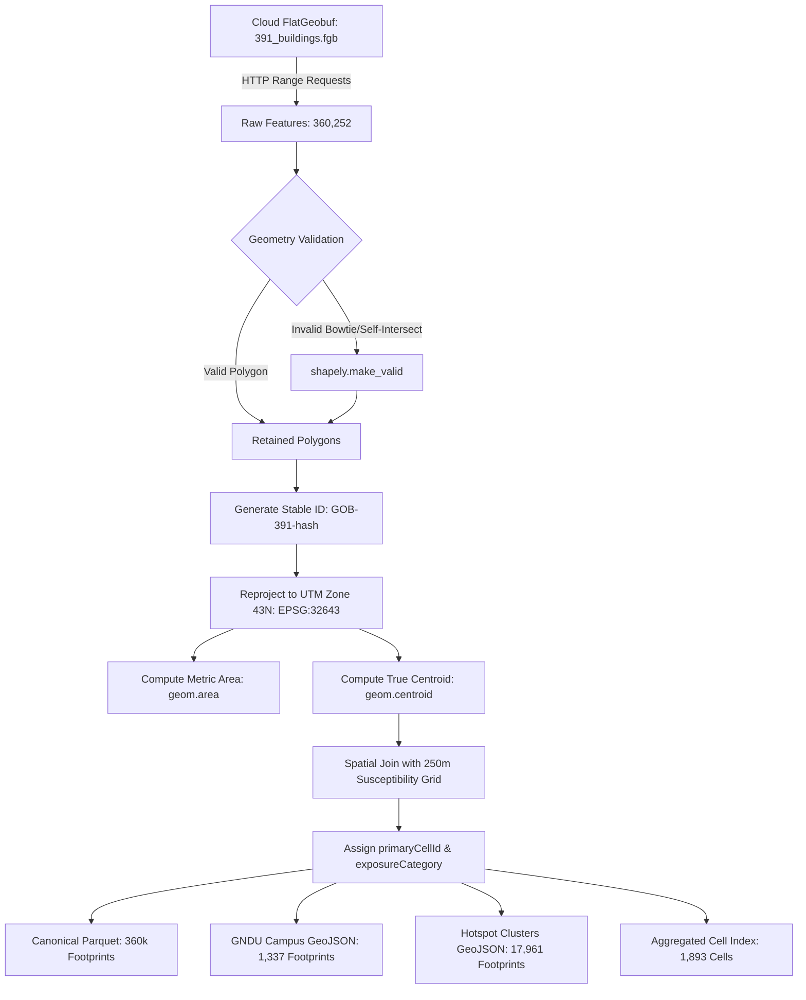

# Amritsar Building Data Ingestion & Preprocessing Pipeline

## 1. Executive Summary

Stage P9 expands NEXSTORM's spatial data coverage in Amritsar by implementing a reproducible, cloud-native ingestion pipeline for **Google Open Buildings V3**. 

Prior to Stage P9, the repository contained only **452 OpenStreetMap building polygons** across Amritsar, of which 419 were generic `building: yes` tags without structural attributes or completeness. This gap made building-level exposure assessment mathematically untenable.

Stage P9 successfully ingests, validates, and partitions **360,252 real building footprints** across the Amritsar municipal urban extent, computing metric footprint areas in UTM Zone 43N, matching footprints to the 250m susceptibility grid, and generating scalable, cell-partitioned spatial artifacts that avoid browser memory saturation.

---

## 2. Dataset Provenance, Licensing & Acquisition

### 2.1 Source Metadata
- **Dataset**: Google Open Buildings Version 3 (v3).
- **Publisher**: Google Research.
- **License**: Creative Commons Attribution 4.0 International (CC-BY-4.0) and Open Data Commons Open Database License (ODC-BY).
- **Citation**: *Google Open Buildings, Google Research (2023)*.
- **Geographic Partition**: S2 Cell Level 4 Token **`391`** (covering northwestern India and the Amritsar region).
- **Target Urban Extent**: $[74.800^\circ\text{ E}, 31.575^\circ\text{ N}, 74.935^\circ\text{ E}, 31.685^\circ\text{ N}]$ (covering the 1,998 cells of the Amritsar municipal grid).

### 2.2 Cloud-Native Geospatial Streaming via FlatGeobuf
Rather than downloading the global multi-terabyte dataset or the 15.78 GB uncompressed S2 cell tile, the pipeline streams spatial features directly over HTTP using GDAL's `/vsicurl/` driver and the **FlatGeobuf** (`.fgb`) format hosted on Source Cooperative:
- **Endpoint**: `/vsicurl/https://data.source.coop/cholmes/google-open-buildings/fgb-s2/391_buildings.fgb`
- **Mechanism**: FlatGeobuf stores an internal Hilbert R-tree spatial index at the beginning of the file. The pipeline executes HTTP range requests against the remote index to stream only the byte ranges corresponding to Amritsar's bounding box.
- **Efficiency**: Extracted 360,252 building polygons in 277 seconds without storing multi-gigabyte intermediate dumps.
- **Offline Cache**: A compressed local Parquet copy is automatically saved at `pipeline/inputs/google_open_buildings_amritsar.parquet` (32.9 MB) to support completely offline execution.

---

## 3. Data Processing & Geometry Validation Architecture



### 3.1 Geometry Cleaning & Repair
1. **Empty / Degenerate Filtering**: Features with null or empty geometries are dropped.
2. **Topological Repair**: Self-intersecting polygons or bowtie glitches are repaired using `shapely.make_valid()`.
3. **Type Enforcement**: Only `Polygon` and `MultiPolygon` geometries are retained.
4. **Confidence Filtering**: Features below the Google Open Buildings detection threshold ($\text{confidence} < 0.65$) are rejected.

### 3.2 Metric CRS & Area Calculations
- **Projection**: Projected from WGS84 (`EPSG:4326`) to **UTM Zone 43N (`EPSG:32643`)**, the standard conformal metric projection for Punjab (central meridian $75^\circ\text{ E}$, false easting $500,000\text{ m}$).
- **Footprint Area**: Calculated directly in metric meters ($m^2$) on the projected plane.
- **Geographic Centroids**: Centroids are computed in metric UTM space and reprojected to WGS84 to prevent coordinate distortion inherent in naive degree centroids.

### 3.3 Stable Identifier Generation
Every building receives a deterministic identifier:
$$\text{buildingId} = \text{"GOB-391-"} + \text{SHA256}(\text{plus\_code} + \text{WKT}_{100})[:12]$$
Identical geometries produce identical IDs across runs, guaranteeing idempotent deduplication.

### 3.4 Spatial Join with 250m Susceptibility Cells
- **Centroid Point-in-Polygon**: Each building centroid is joined against the 1,998 cells in `public/data/cities/amritsar/susceptibility.geojson`.
- **Primary Cell Assignment**:
  - Matched: Assigned `primaryCellId` (e.g., `A-0590`).
  - Unmatched: If a building centroid falls outside the municipal polygon, it is truthfully marked `cellId: "UNMATCHED"` and `exposureCategory: "unmatched"` rather than falsely assigned to the nearest cell.

---

## 4. Scalable Artifacts & Frontend Optimization

Loading 360,000 polygons into the browser would require $>150\text{ MB}$ of GeoJSON and cause browser crash or catastrophic memory exhaustion. NEXSTORM partitions the dataset into four purpose-built artifacts:

| Artifact Path | Format | Size | Record Count | Operational Purpose |
| :--- | :--- | :---: | :---: | :--- |
| `pipeline/outputs/amritsar_buildings.parquet` | GeoParquet (Snappy) | **32.9 MB** | **360,252** | Canonical offline archive for research, spatial queries, and backend analytics. |
| `public/data/cities/amritsar/buildings/cell_index.json` | JSON Index | **180 KB** | **1,893 cells** | Lightweight summary mapping each 250m cell to building count, total footprint area ($m^2$), mean footprint area, and exposure category. Consumed by `/api/cell/[cellId]`. |
| `public/data/cities/amritsar/gndu/buildings.geojson` | GeoJSON | **285 KB** | **1,337** | Instant polygon rendering for the secondary GNDU campus interactive view. |
| `public/data/cities/amritsar/buildings/hotspot_buildings.geojson` | GeoJSON | **1.9 MB** | **17,961** | High-resolution footprints within 300m of the 15 verified historical waterlogging hotspots. |
| `pipeline/outputs/building_ingestion_summary.json` | JSON Audit | **1 KB** | 1 | Complete audit metrics, timestamps, and input/output counts. |

---

## 5. Scientific Guardrails & Non-Inference Boundaries

NEXSTORM enforces strict scientific guardrails to prevent misleading users:

```
┌─────────────────────────────────────────────────────────────┐
│ SCIENTIFIC NON-INFERENCE BOUNDARIES                         │
├──────────────────────────────┬──────────────────────────────┤
│ Permitted Physical Features  │ Strictly Prohibited Claims   │
├──────────────────────────────┼──────────────────────────────┤
│ • Footprint 2D polygon       │ • Building height / floors   │
│ • Metric footprint area (m²) │ • Indoor flood depth (cm)    │
│ • Centroid coordinates       │ • Plinth / doorstep height   │
│ • Intersecting 250m cell ID  │ • Basement existence         │
│ • Macro-catchment exposure   │ • Structural damage risk     │
│ • Detection confidence score │ • Floor-level occupancy type │
└──────────────────────────────┴──────────────────────────────┘
```

1. **Exposure vs. Vulnerability**: A building in a cell with high susceptibility ($S \ge 0.66$) receives an `exposureCategory: "high_catchment"`. This indicates that the **surrounding land catchment is prone to water accumulation**, NOT that the interior of the building is flooded.
2. **Confidence Interpretation**: The `confidence` attribute ($\in [0.65, 1.0]$) represents the **satellite computer vision model's confidence that a building exists**, NOT a probability that it will flood.

---

## 6. Reproduction Commands

To reproduce the building footprint ingestion pipeline:

```bash
# Full ingestion (streams from canonical FlatGeobuf or uses local cache)
.venv\Scripts\python.exe pipeline/scripts/12_ingest_buildings.py --bbox 74.80 31.575 74.935 31.685

# Fast test run (capped at 5,000 records)
.venv\Scripts\python.exe pipeline/scripts/12_ingest_buildings.py --max-records 5000

# Offline execution (uses local Parquet cache without hitting network)
.venv\Scripts\python.exe pipeline/scripts/12_ingest_buildings.py --offline

# Pipeline runner target
.venv\Scripts\python.exe pipeline/run.py buildings
```
