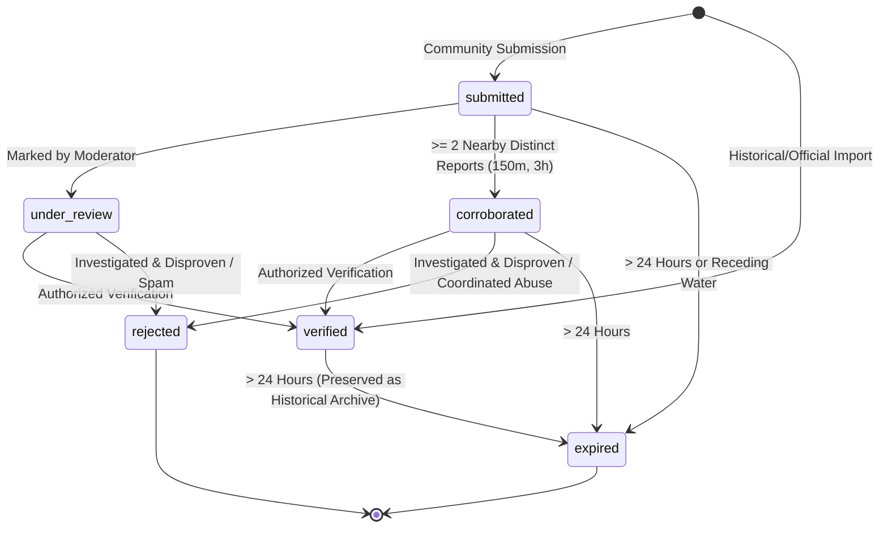

# NEXSTORM Observation Verification & Moderation Policy

**Effective Date:** October 15, 2026  
**Jurisdiction:** Amritsar Pilot Area, Punjab  
**Standard:** Scientific Non-Inference & Transparent Ground-Truth Auditing  

---

## 1. Core Operating Directive

NEXSTORM maintains an uncompromised barrier between **observed ground truth**, **community reports**, and **calibrated risk models**:

> **Rule 1: Corroboration is not Verification.**  
> A community report never becomes `verified` merely because multiple citizens submit similar claims. Multiple reports elevate status to `corroborated`, signaling high investigative priority, but independent verification requires an authoritative review mechanism.

> **Rule 2: Models do not self-calibrate on unvetted submissions.**  
> Community reports are never fed into the hydrometeorological risk matrix or susceptibility weights as automated ground truth without passing formal verification.

> **Rule 3: Transparency beats opaque scoring.**  
> NEXSTORM does not output an arbitrary or unexplained "citizen trust score". Every observation exposes its raw evidence: time elapsed, number of independent corroborators, spatial snapping quality, and verification audit trail.

---

## 2. Observation Lifecycle State Machine

An observation exists in exactly one lifecycle state at any time:

### State Definitions & Permitted Transitions

| Lifecycle State | Meaning | Permitted Next States |
| :--- | :--- | :--- |
| `submitted` | Initial state for any newly received citizen observation. | `under_review`, `corroborated`, `expired`, `rejected` |
| `under_review` | Queued for manual triage or telemetric validation by an authorized reviewer. | `verified`, `rejected` |
| `corroborated` | Automatically assigned when $\ge 2$ independent reports from distinct reporters coincide within 150m and 3 hours. | `verified`, `rejected`, `expired` |
| `verified` | Formally confirmed by an authorized observer, police advisory, municipal notice, or photo/sensor inspection. | `expired` |
| `rejected` | Investigated and identified as fabricated, spam, duplicate abuse, or demonstrably false. | Terminal (retained for audit logs; hidden from public map layers) |
| `expired` | Incident has ended or elapsed beyond operational shelf life. Historical records remain viewable as archives. | Terminal (cannot be re-activated as current road condition) |

---

## 3. Freshness & Expiry Guidelines

Waterlogging is a dynamic, transient phenomenon. Old reports must never be presented to commuters as current road conditions:

1. **Active Window ($< 6\text{ hours}$)**:
   - Fresh observation. Actively rendered on the live console map.
2. **Stale Threshold ($6\text{ to }24\text{ hours}$)**:
   - Observation is flagged with `isStale: true`. Displayed with visual aging indicator to warn reviewers that drainage may have occurred.
3. **Operational Expiry ($> 24\text{ hours}$)**:
   - Observation transitions to `isExpired: true`.
   - Excluded from active road routing hazards and current map layers.
4. **Immediate Receding Expiry**:
   - Observations tagged with `category: 'receding_water'` are immediately marked as `isExpired: true` to prevent false obstruction alarms.

---

## 4. Corroboration Engine & Abuse Prevention

To prevent single-actor manipulation, griefing, or coordinated astroturfing:

### 4.1 Independent Reporter Clustering
- **Distance Radius**: 150 metres in projected UTM Zone 43N coordinates.
- **Temporal Window**: $\pm 3\text{ hours}$ from observed event time.
- **Distinct Origin Rule**: Reports must possess distinct `reporterHash` values. Two reports from the same IP/subnet/UA fingerprint do **not** increment the corroboration counter.
- **Corroboration Threshold**: Status upgrades to `corroborated` only when $\ge 2$ distinct corroborating reports exist.

### 4.2 Rate Limiting & Duplicate Detection
- **IP Rate Limit**: Sliding window enforcing a maximum of **5 submissions per 10 minutes** per IP address (returns HTTP 429 when exceeded).
- **Spatial Deduplication**: If a submission originates from the same `reporterHash` within **50 metres** and **15 minutes** of an existing submission, the server rejects it with HTTP 409 (`DUPLICATE_OBSERVATION`).
- **Geographic Bounds Filter**: Coordinates must strictly fall within the Amritsar pilot boundary ($[31.50^\circ\text{ N}, 74.70^\circ\text{ E}]$ to $[31.80^\circ\text{ N}, 75.05^\circ\text{ E}]$).

---

## 5. Verification Standards & Audit Trail

Verification is an audited, immutable operation. The endpoint `PATCH /api/observations/[id]/verify` enforces strict authorization:

### 5.1 Permitted Verification Methods
1. `field_inspection`: On-site visit by designated municipal engineering crew or verified field observer.
2. `traffic_police_notice`: Official broadcast or traffic diversion bulletin from Amritsar Traffic Police.
3. `news_report`: Documented incident published by a reputable news organization (e.g. The Tribune India archive).
4. `sensor_telemetry`: Automated ultrasonic road water depth gauge or municipal telemetry.
5. `municipal_advisory`: Municipal Corporation Amritsar (MCA) emergency control room bulletin.

### 5.2 Immutable Verification Record
Every verification action records:
- `isVerified`: `true` (or `false` if rejecting).
- `verifiedAt`: ISO-8601 UTC timestamp of the review action.
- `verifiedBy`: Redacted agency or inspector identifier (e.g. `MCA-Ward-8-Inspector`).
- `verificationMethod`: One of the 5 enumerated methods above.
- `verificationNotes`: Contextual audit notes (e.g. "Culvert blockage cleared by jetting machine at 14:30").

---

## 6. Photo Evidence & Privacy Safeguards

1. **Optional Evidence**: Photographs can corroborate visual depth, but do not replace geographic and timestamp verification.
2. **Metadata Sanitization**: When file upload infrastructure is provisioned, EXIF tags (including camera serial numbers, GPS tags, and embedded thumbnails) must be stripped server-side.
3. **URL Validation**: In this local development stage, photo URLs are restricted to secure `http`/`https` protocols. Executable schemes (`javascript:`, `data:`, `blob:`) are rejected by Zod schema validation.
