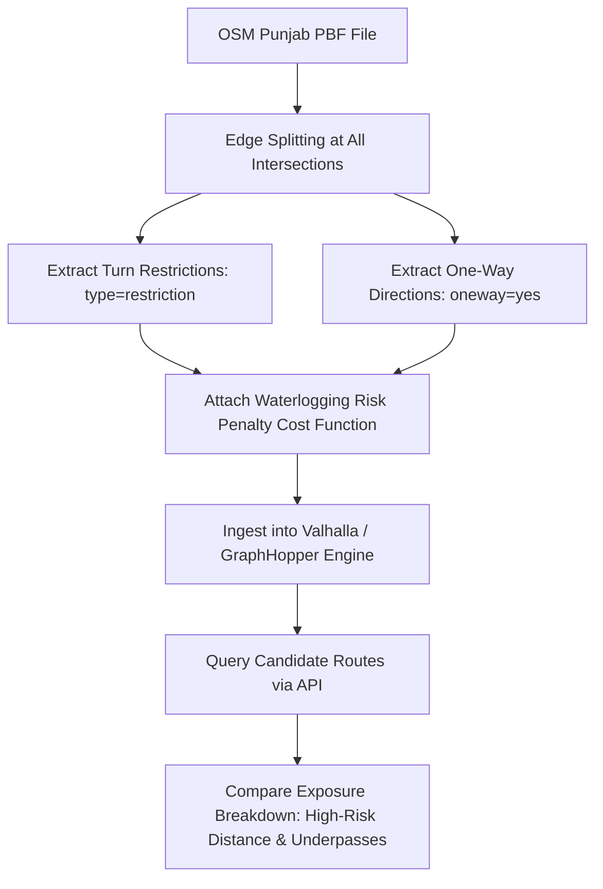

# Road Network Preparation & Topological Graph Architecture

## 1. Executive Summary

Stage P9 establishes the road network data preparation and topological graph foundation for **NEXSTORM**, addressing the critical gap identified in Stage P8: the existing 14,855 OpenStreetMap road segments were flat geometric lines lacking topological connectivity, grade-separation awareness, or spatial catchment risk linkage.

The road preprocessing pipeline (`pipeline/scripts/13_prepare_roads.py`) standardizes the road network, preserves OpenStreetMap attributes, calculates metric lengths in UTM Zone 43N, identifies railway underpasses and bridges, extracts topological junction nodes, and links road corridors to NEXSTORM's 250m susceptibility grid.

---

## 2. Road Dataset Inventory & Attribute Extraction

### 2.1 Source Metadata
- **Source**: OpenStreetMap contributors via Overpass API extract (`pipeline/inputs/osm_features.gpkg`, layer: `roads`).
- **License**: Open Database License (ODbL) 1.0.
- **Coverage**: Full Amritsar municipal extent.
- **Total Input Segments**: 14,855.
- **Valid Retained Segments**: 14,853 (2 degenerate segments $<1.0\text{ m}$ filtered out).
- **Total Physical Road Length**: **1,857.73 kilometers**.

### 2.2 Preserved Source Attributes

| Attribute Name | Source Tag in OSM | Data Type | Operational Purpose |
| :--- | :--- | :--- | :--- |
| `segmentId` | Generated | `string` | Deterministic segment identifier (`AMR-ROAD-<osmid>-<index>`). |
| `osmid` | `way.id` | `string` | Canonical OpenStreetMap Way ID for external cross-referencing. |
| `highway` | `highway` | `string` | Highway hierarchy (trunk, primary, secondary, tertiary, residential, service). |
| `name` | `name` | `string` | Official road name in English/Punjabi where tagged. |
| `length_m` | Computed in UTM 43N | `float` | Metric physical length in meters (EPSG:32643). |
| `is_underpass` | `tunnel=yes` or `layer=-1` | `boolean` | Flags grade-separated railway underpasses and depressed roadways. |
| `is_bridge` | `bridge=yes` or `layer=1` | `boolean` | Flags elevated overpasses and bridges. |
| `from_node` / `to_node` | Extracted | `integer` | Topological start and end vertex IDs for graph construction. |
| `primaryCellId` | Spatial Join | `string` | Intersecting 250m susceptibility grid cell (`A-XXXX`). |
| `cellSusceptibility` | Spatial Join | `float` | Macro-catchment static susceptibility score ($S \in [0, 1]$). |
| `modeledRiskClass` | Derived | `string` | Corridor risk classification (`low`, `moderate`, `high`). |

### 2.3 Highway Classification Distribution

```
Residential:     12,424 segments (83.6%)
Service:          1,128 segments  (7.6%)
Tertiary:           236 segments  (1.6%)
Primary:            183 segments  (1.2%)
Trunk:              152 segments  (1.0%)
Unclassified:       149 segments  (1.0%)
Footway / Path:     183 segments  (1.2%)
Secondary:          123 segments  (0.8%)
Track / Other:      275 segments  (1.9%)
```

---

## 3. Grade Separation: Underpasses & Bridges

Waterlogging in flat alluvial plains concentrates severely at **grade-separated railway underpasses** where the road grade drops 3 to 6 meters below ambient terrain:
- **Identified Underpasses**: **5 segments** explicitly tagged in OSM (`tunnel: yes` or `layer: -1`), matching known ground-truth locations (SSSS Chowk Underpass, Batala Road Railway Crossing, Putlighar Underpass).
- **Identified Bridges / Flyovers**: **160 segments** explicitly tagged (`bridge: yes` or `layer: 1`, e.g., Bhandari Bridge, Elevated Road, GT Road Flyover). Elevated segments maintain natural gravity drainage and rarely waterlog.

---

## 4. Topological Node Extraction & Graph Structure

A raw GIS polyline layer cannot support routing algorithms (Dijkstra, A*, Contraction Hierarchies) because endpoints do not share common node identifiers.

The pipeline executes topological node extraction with coordinate snapping:
1. Endpoints of every segment are rounded to 5 decimal places ($\approx 1.1\text{m}$ ground precision in Amritsar).
2. Shared coordinates are assigned identical deterministic integer vertex IDs.
3. Degree of each vertex is computed:
   - **Total Unique Nodes**: **26,155 vertices**.
   - **Intersection / Junction Nodes** ($\text{degree} \ge 3$): **664 junctions** where paths branch or intersect.
   - **Dead-End Nodes** ($\text{degree} = 1$): **23,355 cul-de-sacs and terminal residential spurs**.

---

## 5. Multi-Cell Spatial Intersection & Risk Weighting (Stage P11)

In Stage P11, road preprocessing was significantly enhanced beyond single centroid snapping to perform exact line-in-polygon multi-cell intersections:
1. **STRtree Spatial Indexing:** 1,998 susceptibility grid cells indexed for rapid query against 14,853 segments.
2. **Intersection Geometry Clipping:** Road polylines crossing multiple cells are split into sub-segments, and exact metric lengths ($L_{i,c}$) in UTM 43N are calculated.
3. **Proportion Normalization:** Normalized by $\max(\sum L_{i,k}, L_i)$ to prevent boundary double-counting.
4. **Exported Artifacts:**
   - `amritsar_roads_prepared.parquet` (1.98 MB): Complete prepared dataset with spatial columns.
   - `major_corridors.geojson` (548 KB): 773 arterial/trunk/primary/secondary/tertiary and underpass segments for 60fps client map rendering.
   - `road_segments_index.json` (9.3 MB): Complete 14,853 segment dictionary.
   - `road_graph.json` (3.78 MB): Directed topological graph nodes and edges.
   - `road_network_topology.json` (1.1 KB): Summary metrics.

---

## 6. Requirements for Future Flood-Aware Routing Engine

While Stage P11 establishes the multi-cell risk weighting and route exposure scoring model (`/api/roads/route-compare`), the following requirements remain for future Stage P13:



1. **Intersection Splitting**: OSM ways often span multiple intersections without being segmented. A production routing graph must split lines at every crossing node.
2. **Turn Restrictions & Directionality**: The source `osm_features.gpkg` does not include `oneway` tags or turn-restriction relations. Consequently, the P11 graph treats edges as bidirectional. Stage P13 should ingest raw OSM PBF data to enforce legal one-ways.
3. **Engine Compatibility**:
   - **Valhalla**: Supports dynamic costing models (Lua/C++) allowing runtime penalty additions for waterlogged segments ($C_e = L_e \cdot (1 + \alpha S_e) + \gamma U_e$).
   - **GraphHopper**: Supports runtime custom JSON weighting models without recompiling contraction hierarchies.

---

## 6. Scientific Caveats & Non-Claims

1. **Catchment Potential vs. Active Flooding**: A road segment intersecting a cell with high susceptibility ($S \ge 0.66$) receives `modeledRiskClass: "high"`. This indicates **high catchment run-off accumulation potential**, NOT that the roadway is flooded or closed.
2. **Impasse Criteria**: A road segment is only designated `impassable` when a fresh, verified citizen or official report confirms active water depth exceeding vehicular thresholds.
3. **No Live Turn-by-Turn Navigation**: NEXSTORM does not provide turn-by-turn guidance or replace municipal navigation services.

---

## 7. Reproduction Commands

To reproduce the road network standardization and topological extraction:

```bash
# Run road network preparation script
.venv\Scripts\python.exe pipeline/scripts/13_prepare_roads.py

# Or via the pipeline runner target
.venv\Scripts\python.exe pipeline/run.py roads
```
