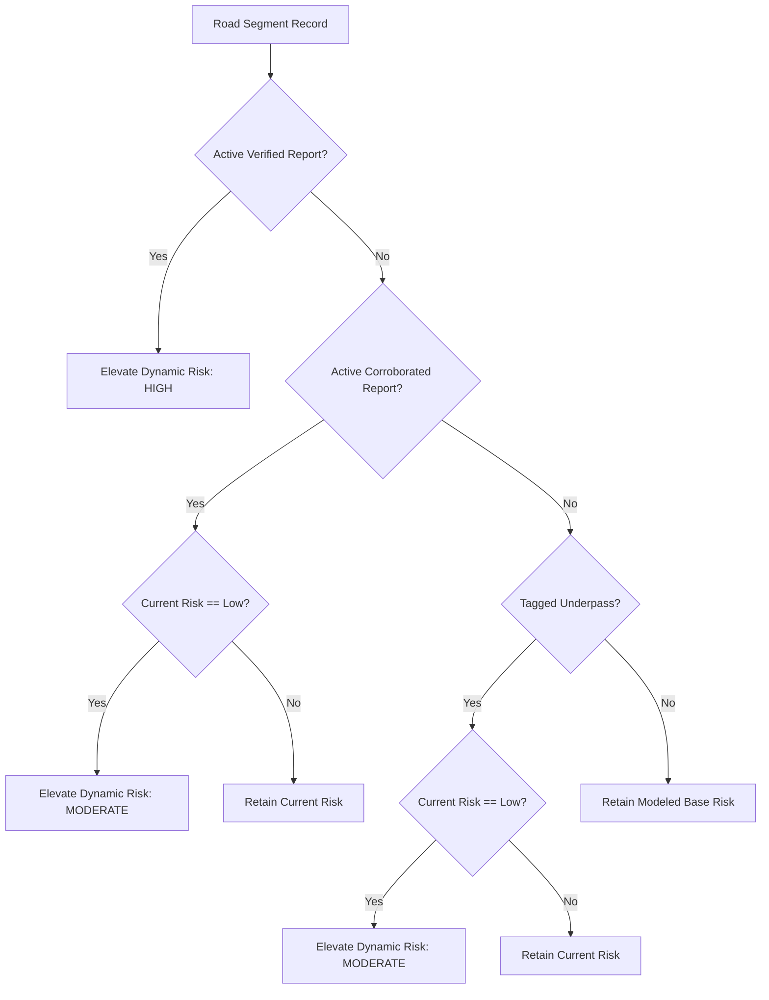

# Road-Segment Waterlogging Risk Assessment & Routing Foundation

**NEXSTORM Research & Engineering Documentation — Stage P11**  
**Geographic Scope:** Amritsar, Punjab, India  
**Date:** October 15, 2026  

---

## 1. Executive Summary

Stage P11 establishes the third pillar of the NEXSTORM urban waterlogging intelligence system: **defensible road-segment waterlogging risk assessment and candidate route exposure comparison**.

NEXSTORM's three architectural pillars:
1. **Area-level susceptibility and rainfall-triggered risk** (250m macro-catchment grid).
2. **Building-level exposure assessment** (individual footprint associations).
3. **Road-segment risk assessment & flood-aware routing foundation** (corridor hazard aggregation & dynamic elevation).

P11 transforms 14,853 flat OpenStreetMap road geometries into an auditable spatial asset where:
- Every segment preserves deterministic multi-cell intersections with the 250m susceptibility grid.
- Known structural chokepoints (5 railway/road underpasses) receive explicit depression risk recognition.
- Active ground-truth community observations from P10 dynamically elevate road hazard states.
- Candidate routes can be evaluated for proportional exposure to flood hazards and ranked by an auditable risk penalty score.

---

## 2. Road Dataset Inventory & Preprocessing Pipeline

### 2.1 Source Data Provenance
- **Source Extract:** OpenStreetMap contributors (`pipeline/inputs/osm_features.gpkg`, layer: `roads`).
- **License:** Open Database License (ODbL) 1.0.
- **Raw Features:** 14,855 polylines.
- **Valid Segments:** 14,853 segments retained (2 degenerate polylines $<1.0\text{ m}$ filtered out).
- **Total Network Length:** 1,857.73 kilometers.
- **Coordinate Reference System:** EPSG:4326 (WGS84) for storage; EPSG:32643 (UTM Zone 43N) for metric geodesic computations.

### 2.2 Preserved Source Attributes & Ground-Truth Tags
| Field | Source Tag | Type | Role |
| :--- | :--- | :--- | :--- |
| `segmentId` | Generated | `string` | Deterministic ID: `AMR-ROAD-<osmid>-<index>` |
| `osmid` | `way.id` | `string` | OSM Way ID for auditable cross-referencing |
| `highway` | `highway` | `string` | Classification (trunk, primary, secondary, tertiary, residential, etc.) |
| `name` | `name` | `string` | Official Punjabi/English street name where mapped |
| `lengthM` | Computed in UTM 43N | `float` | Metric physical length in meters |
| `isUnderpass` | `tunnel=yes` or `layer=-1` | `boolean` | Flags grade-separated underpasses (5 identified in Amritsar) |
| `isBridge` | `bridge=yes` or `layer=1` | `boolean` | Flags elevated flyovers/bridges (160 identified) |
| `fromNode` / `toNode` | Extracted | `integer` | Topological start and end vertex IDs |
| `primaryCellId` | Spatial Join | `string` | Identifier of intersecting grid cell with longest length |
| `intersectingCells` | Exact multi-cell join | `list` | All intersected cells with length ($m$) and fraction ($[0, 1]$) |
| `weightedCellSusceptibility` | Area-weighted | `float` | Length-weighted mean susceptibility ($\bar{s}$) |
| `maxCellSusceptibility` | Maximum | `float` | Maximum susceptibility across all crossed cells ($s_{\max}$) |
| `unmatchedFraction` | Geometric remainder | `float` | Proportion of road extending outside grid extent |
| `modeledRiskClass` | Derived | `string` | Base modeled risk (`low`, `moderate`, `high`) |

---

## 3. Multi-Cell Spatial Intersection Formulation

### 3.1 Why Single-Cell Snapping Fails
The average road segment length in Amritsar is 105.1 meters, but **830 road segments exceed 500 meters** (up to 8,843 meters along Grand Trunk Road / National Highway 3). A single road segment frequently crosses multiple 250m grid cells with drastically differing topographic runoff catchments. Snapping a road polyline solely to its centroid or nearest cell hides critical high-risk depressions inside an artificially safe average.

### 3.2 Exact Spatial Intersection Algorithm
The Python preprocessing pipeline (`pipeline/scripts/13_prepare_roads.py`) executes:
1. Spatial indexing of the 1,998 susceptibility grid cells using a GeoPandas `STRtree`.
2. Segment-polygon intersection pairs ($23,867$ pairs evaluated across Amritsar).
3. Metric clipping of road lines by cell polygons in UTM Zone 43N.
4. Per-cell intersection metrics:
   $$\text{fraction}_{i,c} = \frac{L_{i,c}}{\max\left(\sum_{k} L_{i,k}, L_i, 1.0\right)}$$
   $$\bar{s}_i = \sum_{c \in C_i} s_c \cdot \left(\frac{L_{i,c}}{\sum_{k} L_{i,k}}\right)$$
   $$s_{\max, i} = \max_{c \in C_i} s_c$$
   $$\text{unmatchedFraction}_i = \max\left(0, 1.0 - \min\left(1.0, \frac{\sum_k L_{i,k}}{L_i}\right)\right)$$

Normalizing by $\max(\sum L_{i,k}, L_i)$ guarantees that road polylines running along shared cell boundaries cannot double-count length or produce fractional sums exceeding 1.0.

---

## 4. Road Risk Assessment Engine & Dynamic Scoring

### 4.1 Base Modeled Risk
Static road risk reflects topographic and urban built-up runoff susceptibility:
- **High Risk:** $s_{\max} \ge 0.66$ OR `isUnderpass = true`.
- **Moderate Risk:** $0.33 \le s_{\max} < 0.66$.
- **Low Risk:** $s_{\max} < 0.33$.

### 4.2 Dynamic Elevation from Ground-Truth Evidence (P10)
Modeled susceptibility is dynamically reconciled with active observations from the P10 community evidence store:

### 4.3 Scientific Safeguards
1. **Never Confuse Prediction with Observation:** Modeled risk ($s_{\max}$) indicates runoff accumulation propensity based on 250m terrain. Observed waterlogging indicates documented human/municipal evidence.
2. **Missing Reports $\ne$ Safe:** An unreported road is never labeled "flood-free". Unreported roads reflect modeled susceptibility only.
3. **Stale Evidence Expiration:** Observations past their TTL (48 hours for uncorroborated citizen reports, 72 hours for verified) automatically expire and do not elevate road risk.
4. **Independent Verification vs Corroboration:** Multiple citizen reports constitute corroboration (clustering), whereas municipal or field engineer confirmation constitutes independent verification.

---

## 5. Candidate Route Flood Exposure Comparison

### 5.1 Objective
Before routing engines (Valhalla / GraphHopper) can be deployed with dynamic turn restrictions, NEXSTORM provides a rigorous **route exposure scoring model** (`POST /api/roads/route-compare`). It accepts candidate route polylines and evaluates their exposure to flooded or high-risk road corridors.

### 5.2 Exposure & Penalty Formulation
For candidate route $R$ comprising matched segments $S_R$:
- **Exposure by Class:**
  $$E_{\text{high}} = \frac{\sum_{s \in S_R, \text{risk}=\text{high}} L_s}{\sum_{s \in S_R} L_s}, \quad E_{\text{mod}} = \frac{\sum_{s \in S_R, \text{risk}=\text{mod}} L_s}{\sum_{s \in S_R} L_s}, \quad E_{\text{low}} = 1.0 - E_{\text{high}} - E_{\text{mod}}$$
- **Composite Penalty Score ($P_R \in [0, 100]$):**
  $$P_{\text{base}} = 50 \cdot E_{\text{high}} + 25 \cdot E_{\text{mod}}$$
  $$P_{\text{reports}} = \min(30, 15 \cdot N_{\text{active reports}})$$
  $$P_{\text{underpass}} = \min(20, 10 \cdot N_{\text{underpasses}})$$
  $$P_R = \min(100, \text{round}(P_{\text{base}} + P_{\text{reports}} + P_{\text{underpass}}))$$

### 5.3 Safety Recommendation Tiers
- **Recommended ($P_R < 20$):** Negligible flood exposure; no underpass chokepoints.
- **Caution ($20 \le P_R < 50$):** Moderate runoff accumulation exposure or peripheral drainage bottlenecks.
- **Avoid ($P_R \ge 50$ or $N_{\text{underpass}} > 0$ or $E_{\text{high}} > 0.30$):** Traverses severe flood hazard zones, tagged railway underpasses, or active verified waterlogging incidents.

---

## 6. Topological Graph Reality & Source Limitations

### 6.1 Extracted Topology
- **Nodes:** 26,155 vertices.
- **Junction Nodes ($\ge 3$ branches):** 664 vertices.
- **Dead Ends ($\text{degree} = 1$):** 23,355 cul-de-sacs and residential spurs.

### 6.2 Source Limitations & Non-Claims
1. **Absence of One-Way & Turn Restrictions in Source GPKG:**
   The source `osm_features.gpkg` contains geometry, highway class, bridge, tunnel, and layer tags, but **omits `oneway`, `maxspeed`, and relation-based turn restrictions**. Therefore, the graph currently operates as **bidirectional**. Operational turn-by-turn routing must ingest raw OSM XML relations before enforcement.
2. **Not Real-Time Traffic:**
   Road risk assessments represent static terrain susceptibility and documented P10 waterlogging. They do not model live vehicle speeds or congestion.
