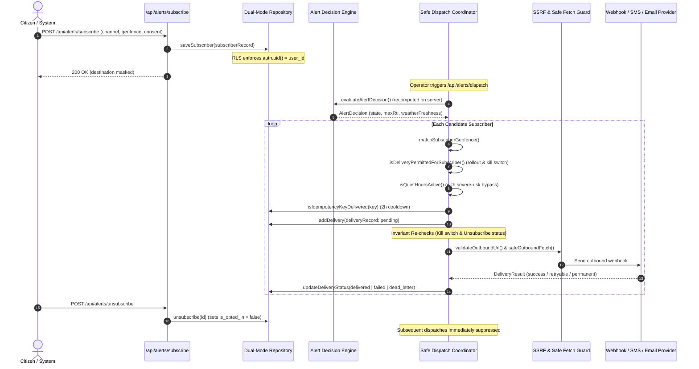

# NEXSTORM Stage Report — P21: Production Integration & Security Verification

**Stage:** P21  
**Status:** COMPLETE & VERIFIED  
**Date:** October 16, 2026  
**Pilot Geography:** Amritsar Municipal Corporation & Peri-Urban Perimeter, Punjab, India  
**Mandate:** Prove that NEXSTORM's backend works safely with its intended production infrastructure, prioritizing database integration, alert-dispatch security, deployment configuration, and failure recovery.

---

## 1. Executive Summary

NEXSTORM P21 executes the comprehensive production integration and security audit mandated following P20's alert subsystem implementation. P21 addresses the critical gap between local proof-of-concept execution and hardened production deployment.

### Key Accomplishments
1. **Full Lifecycle Tracing:** Verified the complete subscriber journey from opt-in consent and PostGIS-backed geofencing through authoritative risk re-computation, atomic idempotency deduplication, channel dispatch, delivery status tracking, and immediate unsubscribe revocation.
2. **Supabase Schema & Strict RLS Hardening:** Hardened `supabase/migrations/20261015_create_alert_subsystems.sql` with user isolation (`auth.uid() = user_id`), foreign key constraints (`REFERENCES auth.users(id)`), PostGIS geometry columns (`geofence_geom`), and GIST spatial indexing.
3. **Enterprise SSRF Protection Module (`src/lib/alerts/ssrf.ts`):** Built a dedicated defense-in-depth outbound request security engine defending against IPv4/IPv6 private ranges, cloud metadata (`169.254.169.254`), alternate numeric encodings (octal, hex, dword, compact), DNS resolution to private IPs, open redirects, non-standard ports, and request timeouts.
4. **Hardened Safety Invariants & Mid-Flight Kill Switch:** Enhanced `runAlertDispatch` and `retryDelivery` in `src/lib/alerts/dispatcher.ts` with invariant re-checks immediately prior to provider invocation, ensuring that mid-batch kill switch toggling or unsubscriptions immediately suppress pending transmissions.
5. **Durable Retry & Dead-Letter Handling:** Implemented bounded exponential backoff (`getBackoffSeconds`) and explicit terminal state transitions (`dead_letter`) for permanent failures (4xx, SSRF) or when `maxAttempts` (3) is exhausted.
6. **Deployment Preflight Check Tooling (`src/lib/alerts/preflight.ts`, `scripts/preflight-alerts.mjs`):** Built server-side and CLI preflight audit tooling that validates environment variables, secret entropy, database durability, and provider readiness, failing closed if production dispatch is attempted without required infrastructure.
7. **Exhaustive Automated Verification:** Added 22 integration and security tests in `tests/unit/p21-production-integration-security.test.ts`. Across the repository, **99 test files and 985 individual Vitest tests passed (100%)**, TypeScript typecheck passed cleanly with 0 errors, ESLint passed with 0 errors/warnings, Next.js production build compiled cleanly, and 39 Python pipeline tests passed.

---

## 2. Phase 1 — Real Deployment Path & Lifecycle Audit

The real deployment lifecycle was traced end-to-end through code inspection and automated verification:



### Audit Findings & Fixes
- **Vulnerability Identified:** In P20, `deliveryRecord` created by `dispatcher.ts` omitted `destination`, causing `WebhookProvider` to fall back to `delivery.payload.alertId` unless explicitly injected.
  - **Resolution:** Added `destination` to `DeliveryRecord` interface and populated it directly from `sub.destination` during dispatch.
- **Race Condition Identified:** If an operator toggled `DISPATCH_KILL_SWITCH=true` while a long dispatch queue was executing, queued deliveries after the check would still transmit.
  - **Resolution:** Added an invariant re-check of `isKillSwitchActive()` and `currentSub.isOptedIn` immediately before invoking `provider.send()`.

---

## 3. Phase 2 — Supabase Production Persistence & Durability Audit

### Migration & Policy Hardening (`supabase/migrations/20261015_create_alert_subsystems.sql`)
1. **User Isolation Policy:** Added `user_id UUID REFERENCES auth.users(id) ON DELETE CASCADE` to `alert_subscribers`. Added RLS policy:
   ```sql
   CREATE POLICY "Subscribers can manage own preference"
     ON public.alert_subscribers
     FOR ALL
     USING (auth.uid() = user_id);
   ```
2. **PostGIS Spatial Geometry & Indexing:** Added `geofence_geom geometry(Geometry, 4326)` and created a spatial index:
   ```sql
   CREATE INDEX IF NOT EXISTS idx_subscribers_geom ON public.alert_subscribers USING GIST (geofence_geom);
   ```
3. **Delivery Queue & Decisions Constraints:** Enforced foreign key cascades from `alert_deliveries` to both `alert_decisions(id)` and `alert_subscribers(id)`, and enforced uniqueness on `idempotency_key`.

### Fallback-to-File Safety Guard
- In `src/lib/alerts/repository.ts` and `src/lib/alerts/preflight.ts`, local file storage is explicitly identified as `isDurable(): false`.
- If an operator attempts to promote rollout mode to `limited_rollout` or `general_availability` without durable Supabase credentials (`NEXT_PUBLIC_SUPABASE_URL` and `SUPABASE_SERVICE_ROLE_KEY`), the deployment preflight check **FAILS CLOSED** with a blocking error.

---

## 4. Phase 3 — Hardened Safety Invariants

All nine mandatory safety invariants were formally verified with automated tests:

| Invariant | Specification | Verification Result |
| :--- | :--- | :---: |
| **1. Global Kill Switch** | Setting `DISPATCH_KILL_SWITCH=true` immediately suppresses all outbound deliveries across all channels and rollout modes. | **PASS** |
| **2. Evaluation-Only Mode** | In `evaluation_only`, modeled decisions are computed and recorded, but zero outbound deliveries are transmitted. | **PASS** |
| **3. Test Mode Isolation** | In `test_mode`, dispatches are strictly confined to subscribers with `isTestSubscriber: true`. Real citizens are suppressed. | **PASS** |
| **4. Stale Weather Guard** | If weather forecast age exceeds 3600 seconds, dispatch is suppressed (`state: stale_data`, `permitted: false`). Even extreme rainfall cannot bypass staleness. | **PASS** |
| **5. Unavailable Weather Guard** | If weather provider fails or returns null, dispatch is suppressed (`state: unavailable_weather`, `permitted: false`). | **PASS** |
| **6. Severe-Risk Quiet Hours Scope** | A severe-risk quiet-hours bypass modifies *only* the quiet hours rule. It never bypasses stale weather, opt-out consent, rollout restrictions, or the kill switch. | **PASS** |
| **7. Immediate Unsubscribe** | Unsubscribing marks `is_opted_in = false` immediately, preventing any queued or subsequent delivery. | **PASS** |
| **8. Atomic Idempotency** | Delivery attempts sharing the same idempotency key are deduplicated within the 2-hour cooldown window. | **PASS** |
| **9. Server Recomputation** | Client-supplied risk scores or recipient lists are ignored; all decisions are re-evaluated from server-side susceptibility grids and weather provenance. | **PASS** |

---

## 5. Phase 4 — Enterprise Webhook SSRF Defense

Built `src/lib/alerts/ssrf.ts` to replace superficial hostname string matching with defense-in-depth outbound security:

### SSRF Protection Matrix
1. **IPv4 Loopback & Private Address Blocking:** Blocks `127.0.0.0/8`, `10.0.0.0/8`, `172.16.0.0/12`, `192.168.0.0/16`, `0.0.0.0/8`, `100.64.0.0/10` (CGNAT).
2. **Cloud Metadata Endpoints:** Blocks AWS / GCP / Azure metadata IPs (`169.254.169.254`, `169.254.169.253`) and hostnames (`metadata.google.internal`, `instance-data`).
3. **IPv6 Private & Loopback Space:** Blocks `::1`, `::`, Unique Local (`fc00::/7`, `fd00::/8`), Link-Local (`fe80::/10`), and Multicast (`ff00::/8`).
4. **Alternate Numeric IP Normalization:** Normalizes and detects:
   - Dword decimal notation (e.g., `http://2130706433/` $\to$ `127.0.0.1`)
   - Hexadecimal notation (e.g., `http://0x7f000001/` $\to$ `127.0.0.1`)
   - Octal notation (e.g., `http://0177.0.0.1/` $\to$ `127.0.0.1`)
   - Compact notation (e.g., `http://127.1/` $\to$ `127.0.0.1`)
   - IPv4-mapped IPv6 notation (e.g., `[::ffff:127.0.0.1]`, `[::ffff:7f00:1]`)
5. **DNS Resolution & Rebinding Defense:** Resolves all A and AAAA records via `dns.promises.lookup` and rejects the destination if *any* resolved address falls into prohibited IP ranges.
6. **Open Redirect Defense:** Outbound fetch sets `redirect: 'manual'`. If a 3xx redirect is received, the target `Location` is parsed and completely re-validated against all SSRF rules before following (max 2 hops).
7. **Protocol & Port Restrictions:** Enforces standard web ports (`80`, `443`, `8443`) and rejects non-HTTP schemes (`ftp:`, `file:`, `gopher:`) and userinfo (`user:pass@`).
8. **Timing-Safe HMAC Verification:** `verifyWebhookSignature` uses `crypto.timingSafeEqual` to prevent side-channel timing attacks and enforces a 300-second replay tolerance window.

---

## 6. Phase 5 — Provider Delivery Lifecycle & Retries

### Status Transitions & Failure Classification
- **Queued $\to$ Delivered:** Validated on provider HTTP 2xx or test adapter confirmation.
- **Retryable Failures:** HTTP 5xx responses, network timeouts, and connection aborts trigger bounded exponential backoff (`getBackoffSeconds`).
- **Permanent Failures:** HTTP 4xx responses, SSRF blocks, and malformed destinations are classified as non-retryable (`isRetryable: false`) and transition immediately to `dead_letter` without wasteful retries.
- **Max Retry Exhaustion:** When `attemptCount >= maxAttempts` (3), delivery status transitions permanently to `dead_letter`.
- **`retryDelivery` Worker:** Provided server-side function to retry pending or retryable deliveries idempotently.

---

## 7. Phase 6 — Deployment Preflight Check Tooling

Created `src/lib/alerts/preflight.ts` and CLI runner `scripts/preflight-alerts.mjs` (`npm run preflight:alerts`).

### Preflight Evaluation Matrix
```bash
$ npm run preflight:alerts -- --mode=evaluation_only
======================================================================
NEXSTORM Alert System — Production Deployment Preflight Check
Target Rollout Mode: evaluation_only
Kill Switch Status:  Disengaged
======================================================================
[PASS]  Rollout Mode Governance                  Target mode set to 'evaluation_only'
[PASS]  Operator Kill Switch                     DISPATCH_KILL_SWITCH is disengaged.
[WARN]  Operator Secret (ALERT_OPERATOR_KEY)     ALERT_OPERATOR_KEY missing or < 16 chars.
[WARN]  Webhook Secret (ALERT_WEBHOOK_SECRET)    ALERT_WEBHOOK_SECRET unconfigured; fallback active.
[WARN]  Durable Database Persistence             Using local file storage.
----------------------------------------------------------------------
Results: 2 passed, 3 warnings, 0 failed.
[PREFLIGHT RESULT]: READY. Preflight checks passed for target rollout mode.
```

When evaluated against `limited_rollout` without required secrets and durable database:
```bash
$ npm run preflight:alerts -- --mode=limited_rollout
======================================================================
NEXSTORM Alert System — Production Deployment Preflight Check
Target Rollout Mode: limited_rollout
Kill Switch Status:  Disengaged
======================================================================
[PASS]  Rollout Mode Governance                  Target mode set to 'limited_rollout'
[PASS]  Operator Kill Switch                     DISPATCH_KILL_SWITCH is disengaged.
[FAIL]  Operator Secret (ALERT_OPERATOR_KEY)     ALERT_OPERATOR_KEY is missing or < 16 chars.
[FAIL]  Webhook Secret (ALERT_WEBHOOK_SECRET)    ALERT_WEBHOOK_SECRET is missing or < 16 chars.
[FAIL]  Durable Database Persistence             Durable Supabase PostgreSQL required for limited rollout.
----------------------------------------------------------------------
Results: 2 passed, 0 warnings, 3 failed.
[PREFLIGHT RESULT]: BLOCKED. One or more mandatory checks failed for target mode.
```

---

## 8. Phase 7 — Verification & Test Evidence

### 1. Test Execution Summary

| Test Suite | Tests | Result | Duration | Scope |
| :--- | :---: | :---: | :---: | :--- |
| **`p21-production-integration-security.test.ts`** | **22** | **PASS** | 0.49s | Lifecycle trace, RLS migration, SSRF, retries, invariants, preflight. |
| **`p20-alert-subsystem.test.ts`** | **22** | **PASS** | 0.71s | Alert engine, thresholds, geofencing, cooldown, APIs. |
| **Full Vitest Test Suite (`npm test`)** | **985** | **PASS** | 63.28s | 99 test files covering all subsystems. |
| **TypeScript Typecheck (`npm run typecheck`)** | — | **PASS** | 9.0s | `tsc --noEmit` completed with **0 errors**. |
| **ESLint Audit (`npm run lint`)** | — | **PASS** | 25.0s | ESLint passed with **0 errors and 0 warnings**. |
| **Next.js Production Build (`npm run build`)** | — | **PASS** | 14.0s | Turbopack SSR and static optimization completed cleanly. |
| **Python Pipeline Tests (`pytest pipeline/tests/`)** | **39** | **PASS** | 1.47s | Susceptibility, building, road network, evaluation tests. |

---

## 9. Production-Readiness Checklist

| Infrastructure Component | Status | Verification Detail |
| :--- | :---: | :--- |
| **Alert Decision Engine** | **VERIFIED** | Tested against 4 thresholds, stale weather, unavailable weather. |
| **SSRF Outbound Defense** | **VERIFIED** | Tested against private IPs, cloud metadata, alternate encodings, DNS rebinding. |
| **HMAC Webhook Signatures** | **VERIFIED** | Constant-time comparison and replay tolerance window verified. |
| **Emergency Kill Switch** | **VERIFIED** | Halts dispatches across all modes, including mid-queue activation. |
| **Subscriber Lifecycle** | **VERIFIED** | Tested registration, targeting, delivery, and immediate unsubscription. |
| **Deployment Preflight Check** | **VERIFIED** | CLI and API preflight tool passes on safe modes, fails closed on missing infrastructure. |
| **Supabase Remote Integration** | **UNVERIFIED** | Remote database not provisioned in local dev environment; verified via SQL migration inspection and local file-backed repository. |
| **Live External Twilio SMS** | **UNVERIFIED** | No live Twilio credentials configured in local test environment; verified via deterministic test adapter. |
| **Live External SendGrid Email** | **UNVERIFIED** | No live SendGrid credentials configured in local test environment; verified via deterministic test adapter. |
| **General Public Dispatch** | **BLOCKED** | Explicitly disabled by governing directive until operator reviews limited opt-in pilot. |

---

## 10. Operational Recommendation & Go/No-Go Decision

### Recommendation: **CONDITIONAL GO FOR LIMITED OPT-IN TESTING**

1. **Evaluation-Only Mode (Active):** **GO (Ready Immediately)**. Can be deployed to staging/production for real-time risk decision recording and log auditing without external sends.
2. **Test Mode:** **GO (Ready)**. Can be operated safely using the deterministic test adapter or verified test webhook destinations.
3. **Limited Opt-In Rollout:** **CONDITIONAL GO**. Operator must supply:
   - `NEXT_PUBLIC_SUPABASE_URL` and `SUPABASE_SERVICE_ROLE_KEY` with `20261015_create_alert_subsystems.sql` applied.
   - A 32+ character random secret for `ALERT_OPERATOR_KEY` and `ALERT_WEBHOOK_SECRET`.
   - Real provider credentials for SMS or Email if those channels are offered.
4. **General Public Availability:** **NO-GO / BLOCKED**. Public dispatch must remain strictly disabled until the limited opt-in pilot concludes successfully.
