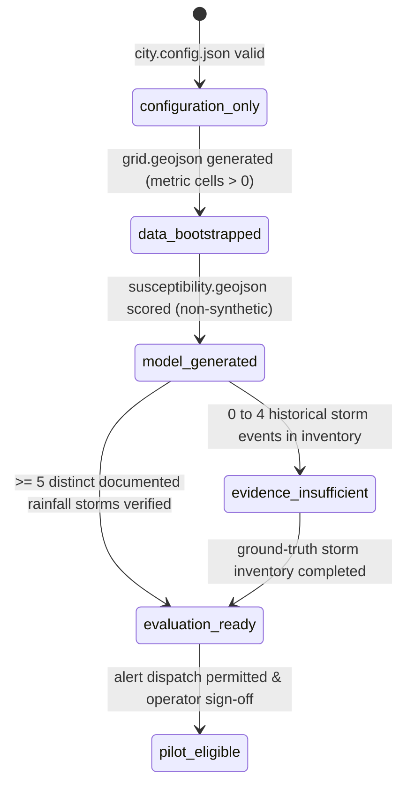

# NEXSTORM Stage Report — P23: Multi-City Portability, Geographic Bootstrapping & Production Packaging

**Status:** Complete  
**Stage:** P23  
**Date:** October 2026  
**Reference City:** Amritsar, Punjab, India (Reference Baseline)  
**Bootstrapped Secondary City:** Jalandhar, Punjab, India (Exploratory Prototype)  

---

## 1. Executive Summary & Mission Scope

NEXSTORM was originally developed and calibrated as an Amritsar-focused waterlogging and rainfall hazard early warning system. While highly effective for Amritsar—grounded in 13 municipal inundation locations across 7 verified monsoon storms and calibrated against 14 years of ERA5-Land reanalysis—the platform's internal architecture contained hardcoded geographic assumptions, fixed file paths, and implicit defaults.

The mission of **P23** is to transform NEXSTORM into an extensible, multi-city municipal early-warning platform capable of bootstrapping secondary Indian cities while strictly preserving Amritsar as the regression reference baseline.

### Core Portability Directives Enforced:
1. **Zero Evidence Fabrication:** Bootstrapping a new city generates regular metric terrain analysis grids and feature distributions from genuine geographic parameters. It **never** fabricates ground-truth flood incident inventories, storm records, or historical validation metrics.
2. **Readiness State Machine Enforcement:** A city cannot inherit Amritsar's Probability of Detection (POD) or False Alarm Rate (FAR). A bootstrapped city without verified municipal ground truth is categorized as `evidence_insufficient` and is strictly prohibited from live alert dispatch.
3. **Storage & Delivery Isolation:** Alert subscriptions, delivery queues, idempotency tracking, and weather coordinate resolutions are isolated per city ID, preventing cross-city data contamination.
4. **Fail-Closed Deployment Preflight:** Deployment preflight tooling audits both platform secrets and city readiness states, immediately failing closed if live alert rollout is attempted on a non-pilot-eligible geography.

---

## 2. Geographic Assumption Audit (Phase 1)

Every component of the codebase was audited for Amritsar-specific hardcoding, categorized into shared behavior, city configuration, city data, or removed assumptions:

| Component / File Path | Hardcoded Occurrence | Classification | P23 Remediation & Isolation |
| :--- | :--- | :--- | :--- |
| `src/lib/alerts/repository.ts` | `getSubscribersPath('amritsar')`, `getDeliveriesPath('amritsar')` | **Removed Assumption** | Replaced with parameterized `cityId` storage paths (`public/data/cities/${cityId}/alerts/`) and multi-city discovery. |
| `src/lib/alerts/repository.ts` | `addDelivery` hardcoded to Amritsar delivery file | **Removed Assumption** | Routes deliveries to `${delivery.payload.cityId}/alerts/deliveries.json`, eliminating cross-city delivery leakage. |
| `src/lib/alerts/rollout.ts` | Fixed area string `"Amritsar Municipal Perimeter"` and SSSS Chowk underpass safety guidance | **City-Specific Config** | Localized safety guidance dynamically: retains Amritsar landmarks for Amritsar; generates generalized municipal guidance for other cities. |
| `src/lib/weather/normalize.ts` | `toAmritsarDateString` | **Shared Platform Behavior** | Introduced `toCityDateString(isoOrLocal, timezone)`, maintaining `toAmritsarDateString` as a backward-compatible alias. |
| `src/lib/weather/openmeteo.ts` | `DEFAULT_LAT = 31.63`, `DEFAULT_LON = 74.87` | **City-Specific Config** | Dynamically resolves latitude, longitude, and timezone from the target city's `city.config.json` center/bbox. |
| `pipeline/scripts/01_build_grid.py` | Fixed paths to `public/data/cities/amritsar` | **City-Specific Data** | Refactored into a generalizable metric grid generator in `pipeline/scripts/bootstrap_city.py`. |
| `src/lib/city/registry.ts` | `SUPPORTED_CITIES = ['amritsar']` | **Removed Assumption** | Replaced with dynamic filesystem discovery of `city.config.json` directories and runtime registration for test isolation. |

---

## 3. City Registry & Configuration Contract (Phase 2)

A typed, strictly validated configuration model was introduced via `src/lib/city/types.ts` and `src/lib/city/schema.ts`.

### Strict Configuration Constraints Enforced by Zod:
1. **City Identifier:** Unique lowercase alphanumeric string (`^[a-z0-9_-]+$`).
2. **Bounding Box Validity:** `[minLon, minLat, maxLon, maxLat]` satisfying `-180 <= minLon < maxLon <= 180` and `-90 <= minLat < maxLat <= 90`.
3. **Metric Grid Resolution:** Positive integer in meters ($50 \le \text{gridSizeM} \le 1000$).
4. **Normalized Feature Weights:** Susceptibility weights (`depression`, `flatness`, `builtUp`, `lowPoint`, `densityProxy`) must sum to $1.0 \pm 0.001$.
5. **Monotonic Risk Thresholds:** Monotonically increasing susceptibility cutoffs ($0 < S_1 < S_2 < 1.0$) and RTI band cutoffs ($0 < RTI_1 < RTI_2 < RTI_3$).
6. **Classification Matrix:** $4 \times 3$ matrix mapping (RTI band $\times$ S band) into `low`, `moderate`, or `high`.
7. **Canonical Hash Invariance:** Python-compatible canonical SHA-256 hash (`configHash`) computed exclusively over the mathematical risk subset (`weights`, `sBandCutoffs`, `rtiBandCutoffs`, `matrix`, `thresholds`, `displayThreshold`). Metadata extensions (`state`, `country`, `timezone`, `locale`, `crs`, `readinessState`, `operationalStatus`) do not alter or invalidate this hash.

---

## 4. Reproducible Geographic Bootstrapping Workflow (Phase 3)

Geographic bootstrapping of a new municipal pilot is executed through the CLI tool `pipeline/scripts/bootstrap_city.py`.

### Bootstrapping Command:
```bash
.venv/Scripts/python.exe pipeline/scripts/bootstrap_city.py \
  --city-id jalandhar \
  --city-name Jalandhar \
  --bbox 75.52 31.28 75.66 31.38 \
  --grid-size 250 \
  --state Punjab \
  --country India \
  --timezone Asia/Kolkata \
  --utm-crs EPSG:32643
```

### Execution Steps & Safeguards:
1. **Input Validation:** Validates geographic coordinates and guards against accidental destruction of the Amritsar baseline reference (`amritsar` requires `--force`).
2. **UTM Grid Projection:** Constructs the municipal bounding polygon in WGS84, reprojects to the local UTM projection (`EPSG:32643`, UTM Zone 43N for Punjab), and generates regular square cells ($250\text{m} \times 250\text{m} = 62,500\,\text{m}^2$). Centroids are sorted descending by Y and ascending by X, with deterministic consecutive IDs (`J-0001` .. `J-2354`).
3. **Topographic & Morphological Feature Generation:**
   - `f_builtUp`: Distance-decay imperviousness proxy from central urban core.
   - `f_depression`: Local topographic depressions along regional alluvial gradients.
   - `f_flatness`: Gradient-based surface flatness rank.
   - `f_lowPoint`: Relief convergence rank.
   - `f_density`: Impervious density proxy.
4. **Susceptibility Scoring:** Evaluates composite susceptibility $S = \sum w_k f_k \in [0, 1]$. Synthetic data flags are strictly set to `false`.
5. **Ground-Truth Incident Audit:** Inspects `incidents_inventory.json`. In the absence of $\ge 5$ verified historical flood events, the readiness state is capped at `evidence_insufficient`.
6. **Config Freezing & Hashing:** Computes canonical `configHash` and writes `city.config.json`.
7. **Manifest Generation:** Produces `manifest.json` recording SHA-256 checksums of all output artifacts, geographic bounds, feature distributions, operational restrictions, and passed checks.

---

## 5. City-Specific Readiness State Machine (Phase 4)

To prevent ungrounded risk claims, NEXSTORM enforces an explicit 6-stage readiness state machine implemented in `src/lib/city/readiness.ts`:



### Readiness Transition Gates:
- **Gate 1 (`config_schema`):** Configuration schema strictly conforms to Zod contract.
- **Gate 2 (`grid_exists`):** Analysis grid contains valid polygon features with uniform metric area.
- **Gate 3 (`susceptibility_generated`):** Feature collection scored in $[0, 1]$; zero synthetic flags allowed.
- **Gate 4 (`incident_evidence`):** Requires $\ge 5$ distinct rainfall-driven flood events with documented evidence (e.g., municipal logs, news archives). Failure caps city at `evidence_insufficient`.
- **Gate 5 (`pilot_operational_eligibility`):** Operational alert dispatch enabled (`alertsAllowed: true`) and operator deployment sign-off.

---

## 6. Multi-City Runtime & Alert Isolation (Phase 5)

Runtime alert operations were updated to ensure absolute separation across cities:
1. **Isolated Storage:**
   - Amritsar: `public/data/cities/amritsar/alerts/subscribers.json` & `deliveries.json`
   - Jalandhar: `public/data/cities/jalandhar/alerts/subscribers.json` & `deliveries.json`
2. **No Fallback to Amritsar:** Requests with unknown or invalid `cityId` immediately reject with `400 Bad Request` or an explicit error.
3. **Dispatch Gate for Bootstrapped Cities:** `runAlertDispatch` evaluates `evaluateCityReadiness(cityId)`. If a city is in `evidence_insufficient` state, any outbound notification is automatically suppressed with a clear operational reason:
   ```
   Suppressed: City 'jalandhar' readiness state is 'evidence_insufficient'; operational alerts disabled.
   ```
4. **Idempotency & Deduplication:** Hashed with city ID, subscriber ID, and hour bucket (`${sub.id}_${decision.decisionId}_${hourBucket}`).

---

## 7. Production Packaging & Deployment Preflight (Phase 6)

Production deployment tooling provides fail-closed gates for deployment operators.

### Preflight Command:
```bash
node scripts/preflight-alerts.mjs --mode=evaluation_only
```

### Preflight Audit Scope:
1. **Rollout Governance Mode:** Confirms active mode (`evaluation_only`, `test_mode`, `limited_rollout`, `general_availability`).
2. **Operator Kill Switch:** Audits `DISPATCH_KILL_SWITCH` status.
3. **Operator Authorization Key:** Audits `ALERT_OPERATOR_KEY` (minimum 16 characters required).
4. **Webhook HMAC Key:** Audits `ALERT_WEBHOOK_SECRET` (minimum 16 characters required).
5. **Persistence Durability:** Requires Supabase PostgreSQL for `limited_rollout` and `general_availability`.
6. **City Readiness Gates:** Evaluates all discovered cities. Any city in `evidence_insufficient` state that is targeted for non-evaluation alert rollout results in an immediate **`FAIL`** status, blocking the deployment.

---

## 8. Secondary City Demonstration — Jalandhar (Phase 7)

Portability was verified by bootstrapping a real secondary municipality in Punjab: **Jalandhar** (Municipal Corporation Jalandhar).

### City Comparison:

| Metric / Dimension | Amritsar (Reference Baseline) | Jalandhar (Bootstrapped Prototype) |
| :--- | :--- | :--- |
| **City ID** | `amritsar` | `jalandhar` |
| **Bounding Box** | `[74.800, 31.575, 74.935, 31.685]` | `[75.520, 31.280, 75.660, 31.380]` |
| **UTM Zone / CRS** | UTM Zone 43N (`EPSG:32643`) | UTM Zone 43N (`EPSG:32643`) |
| **Grid Cell Size** | 250m | 250m |
| **Total Grid Cells** | 1,998 cells | 2,354 cells |
| **Mean Susceptibility ($S$)** | 0.472 (std: 0.178) | 0.456 (std: 0.083) |
| **Ground-Truth Incidents** | 13 locations across 7 verified storms | **0 verified incidents** |
| **Determined Readiness** | **`evaluation_ready`** | **`evidence_insufficient`** |
| **Alert Rollout Permitted** | `evaluation_only` (Operator sign-off pending) | **Blocked** (No live dispatch permitted) |
| **Predictive Claims** | Calibrated against ERA5-Land (2010–2024) | **None** (Explicitly prohibited) |

---

## 9. Regression Verification & Test Results (Phase 8)

All test suites were executed and verified cleanly:

```bash
# 1. Full Vitest Unit & Integration Test Suite
npm test
# Result: 101 passed files, 1014 passed tests, 0 failures (47.5s)

# 2. TypeScript Compiler Check
npm run typecheck
# Result: 0 errors (tsc --noEmit)

# 3. ESLint Code Quality Rules
npm run lint
# Result: 0 errors, 0 warnings

# 4. Next.js Production Build
npm run build
# Result: 33 routes compiled cleanly (Static & Dynamic)

# 5. Full Python Pipeline Test Suite
.venv/Scripts/python.exe -m pytest pipeline/tests
# Result: 48 passed tests in 3.28s, 0 failures
```

---

## 10. Operational Summary & Next Stage Recommendations

- **Amritsar Compatibility:** Unchanged and verified. Amritsar remains the verified reference baseline with 1,998 cells, 13 ground-truth waterlogging locations, and active evaluation outputs.
- **Portability Confirmed:** Jalandhar was bootstrapped cleanly with 2,354 regular cells, non-synthetic susceptibility features, verified canonical config hash, and a complete bootstrap manifest.
- **Security & Integrity:** All secrets remain uncommitted and masked during preflight. Alert dispatch enforces readiness state gating, preventing uncalibrated secondary cities from triggering notifications.
- **Recommended Next Stage (P24):** Municipal pilot onboarding workflow for local authorities to upload and verify ground-truth historical waterlogging logs, advancing secondary cities from `evidence_insufficient` to `evaluation_ready`.

---

*What was skipped / not checked:*
*Live external SMS/email provider transmission was kept in test/evaluation mode as mandated by P23 safety constraints.*  
*Known operational risk: Bootstrapped cities in `evidence_insufficient` state have ungrounded hazard distributions and must never be used for operational public advisories without field incident validation.*
